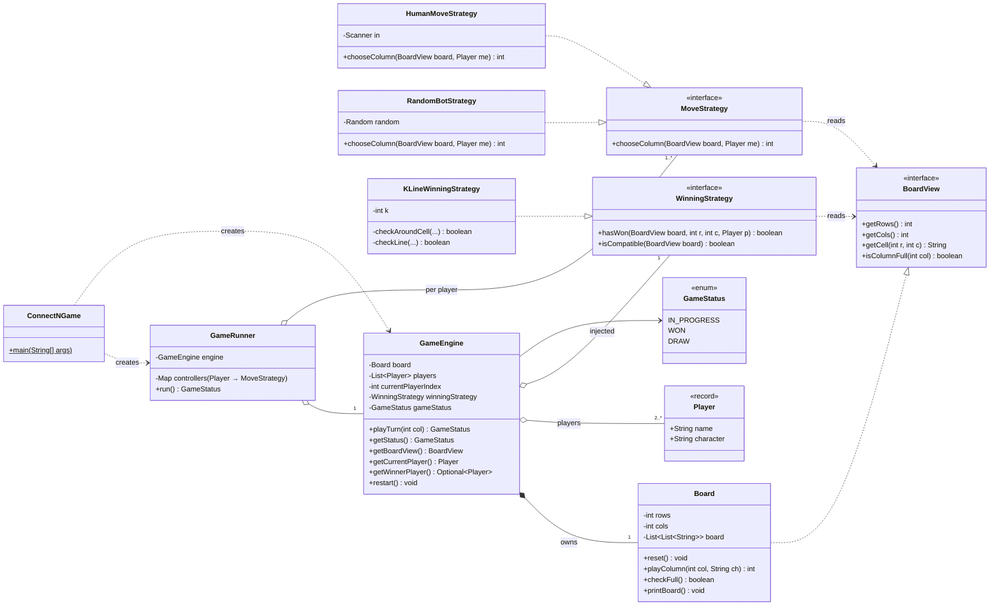
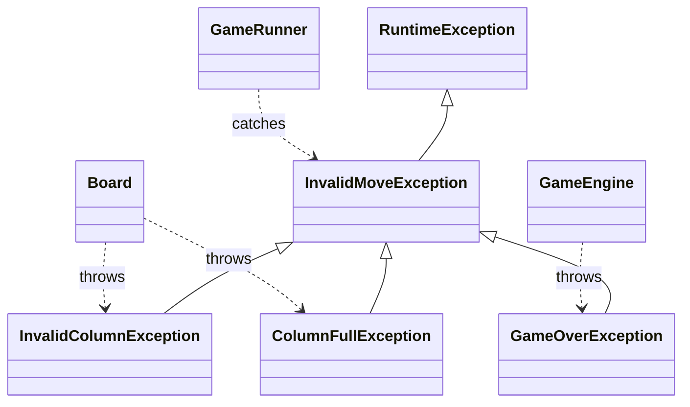

# Connect-N final solution (v6): class diagram

### Exception hierarchy

### Legend
| Arrow | Meaning | In this design |
|---|---|---|
| `..\|>` | implements an interface | `Board` implements `BoardView`, each bot implements `MoveStrategy` |
| `<\|--` | extends a class | the exception classes |
| `*--` | composition: the owner creates the part and controls its lifetime | `GameEngine` creates `Board` in its constructor |
| `o--` | aggregation: the part is passed in from outside | `Player`s, `WinningStrategy`, and the engine passed to `GameRunner` |
| `-->` | association: holds a reference | `GameEngine` holds a `GameStatus` |
| `..>` | dependency: uses it but doesn't keep it | strategies read `BoardView`; classes throw or catch exceptions |

### Points to make when you explain this diagram in an interview
- **There are two Strategy points, each tied to something that can change.** `WinningStrategy` lets you swap the rule for winning. `MoveStrategy` lets you swap how a player chooses a move (human or bot).
- **Interface segregation.** Bots and win rules depend on `BoardView`, a read-only interface. Only `GameEngine` holds the full `Board`, so only the engine can change it.
- **Composition vs aggregation.** The engine *creates* its `Board`, so it owns the board's lifetime. Players and the win rule are *passed in*, so callers can swap them and tests can control them.
- **Open/closed.** `GameRunner` and the `MoveStrategy` implementations were added without touching `GameEngine.playTurn`.
