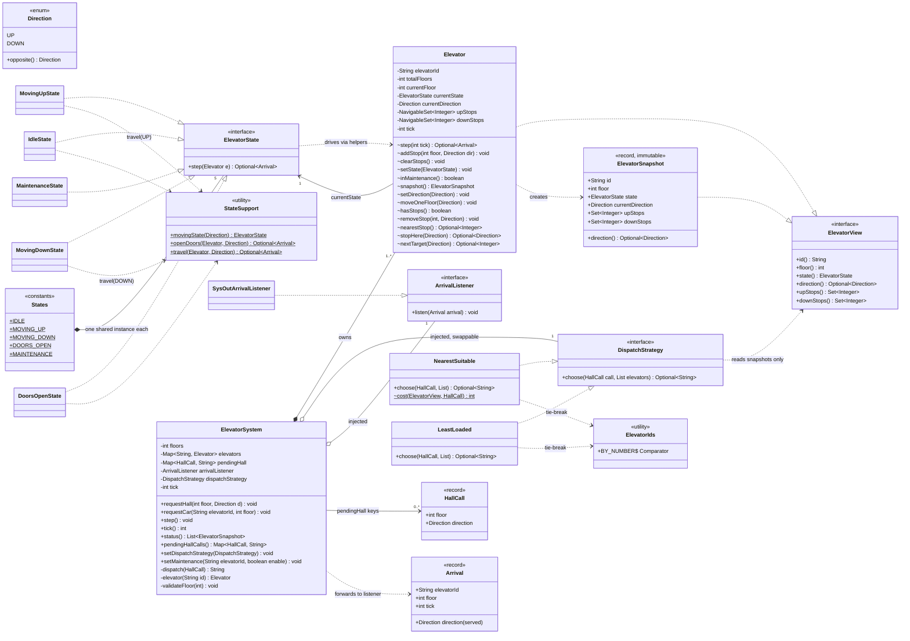
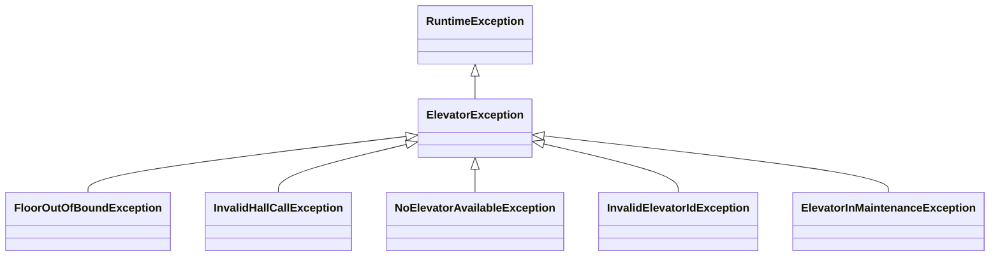
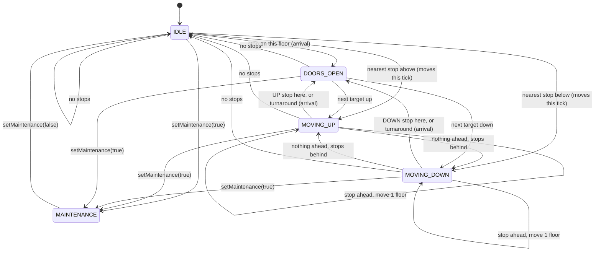
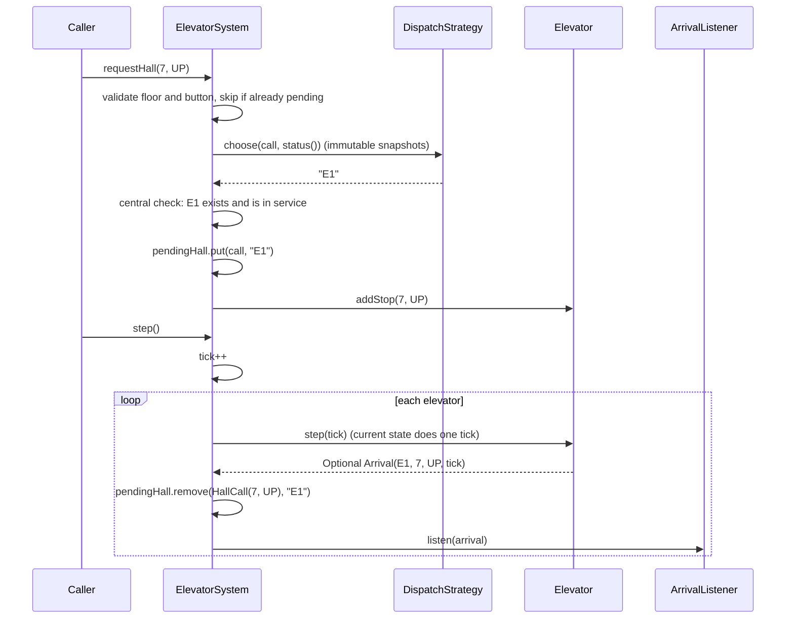

# Elevator solution: class diagram

## Exception hierarchy

## State transitions (one `step()` = one tick)

## What happens on `requestHall` and `step`

## Legend
| Arrow | Meaning | Here |
|---|---|---|
| `..\|>` | implements an interface | the 5 states, `Elevator` and its snapshot, both strategies, the listener |
| `<\|--` | extends a class | the exception classes |
| `*--` | composition: the owner creates the part and controls its lifetime | the system creates and owns its elevators; `States` holds one shared instance of each state |
| `o--` | aggregation: the part is passed in | the dispatch strategy (swappable) and the listener are passed to the system |
| `-->` | association: holds a reference | `Elevator` holds its current state; the system holds the pending `HallCall`s |
| `..>` | dependency: uses it but doesn't keep it | the states use `StateSupport`; strategies read `ElevatorView` snapshots |

## Patterns to name when you explain it
| Pattern | Where | Why it fits |
|---|---|---|
| **State** | `ElevatorState` with 5 implementations | What a tick does depends on the state, and there's no `if/else` on an enum. A new state is a new class. |
| **Strategy** | `DispatchStrategy`: `NearestSuitable`, `LeastLoaded` | The dispatch rule can be swapped at runtime, and a switch affects only future calls. |
| **Mediator** | `ElevatorSystem` | Buttons talk only to the controller, and elevators never talk to each other. |
| **Observer** | `ArrivalListener` | Logging, display and tests subscribe to arrivals without the system knowing who's listening. |
| **Snapshot (immutable view)** | `ElevatorSnapshot` from `status()` | Callers and strategies can read state but never change it. |

## Design points worth saying out loud
- **Hall calls and car calls both become stops inside the elevator, through one `addStop(floor, direction)`.** The **controller** keeps each hall call's identity in `pendingHall`, for removing duplicates and for reassigning calls when an elevator goes into maintenance.
- **Each arrival records the direction being served.** That's how `pendingHall.remove(call, id)` removes the right call, including at a turnaround floor.
- **`setMaintenance` checks before it changes anything.** If the elevator's calls would have nowhere to go, it refuses and changes nothing.
- **There are no threads or sleeps in the core.** Time only moves when `step()` is called, so every test is repeatable. That also sets up Part 2: one simulation thread changes the elevators, while button presses arrive from other threads.