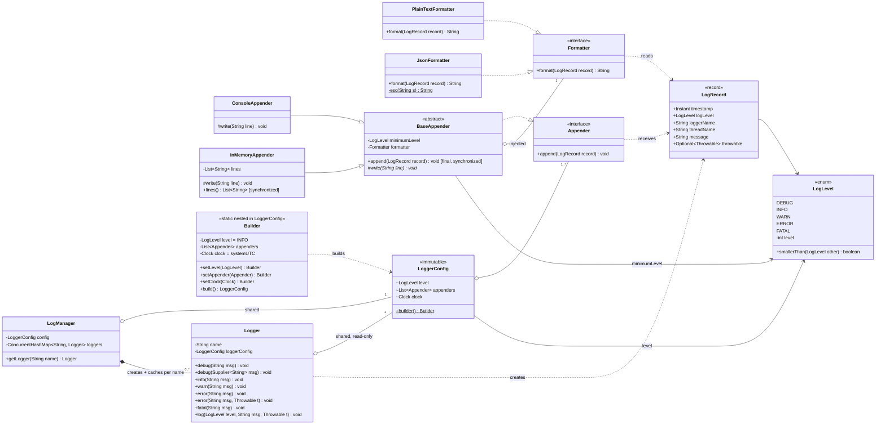
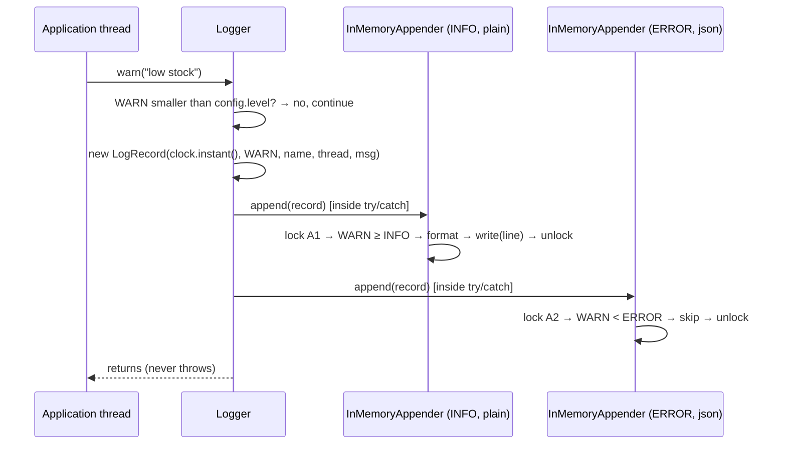

# Logging Framework v0: class diagram

## What happens on one `log.warn(...)` call

## Legend
| Arrow | Meaning | Here |
|---|---|---|
| `..\|>` | implements an interface | each formatter implements `Formatter`; `BaseAppender` implements `Appender` |
| `--\|>` | extends a class | `ConsoleAppender` and `InMemoryAppender` extend `BaseAppender` |
| `*--` | composition: the owner creates the part and controls its lifetime | `LogManager` creates and caches each `Logger` |
| `o--` | aggregation: the part is passed in or shared | the formatter is given to each appender; one `LoggerConfig` is shared by the manager and every logger |
| `-->` | association: holds a reference | `LogRecord` and `BaseAppender` each hold a `LogLevel` |
| `..>` | dependency: uses it but doesn't keep it | `Logger` creates records; formatters and appenders read them |

`Clock` (injected through the Builder) and the test classes (`TestKit`, `MutableClock`) are left out to keep the diagram readable.

## Patterns to name in the interview
| Pattern | Where | Why it fits |
|---|---|---|
| **Strategy** | `Formatter` | Output formats can be swapped or added without edits |
| **Template Method** | `BaseAppender.append` is `final` and calls the abstract `write` | The level check and formatting happen exactly once and can't be skipped; subclasses only decide where the line goes |
| **Builder** | `LoggerConfig.Builder` | Defaults (level INFO, system clock), checks done once in `build()`, and an immutable result |
| **Factory + cache** | `LogManager.getLogger` with `computeIfAbsent` | One logger per name, safe when many threads ask at once |
| **Decorator** *(Part 2)* | `AsyncAppender` wraps any `Appender` | Adds the queue and background thread without changing the appender it wraps |

## Concurrency points shown in the diagram
- **`Logger` has no lock.** It only reads `final` fields of an immutable `LoggerConfig`.
- **Each appender has its own lock** (`synchronized append`), so a slow console doesn't block the in-memory appender.
- **`LogManager` uses `ConcurrentHashMap.computeIfAbsent`**, so the same name never ends up with two loggers.