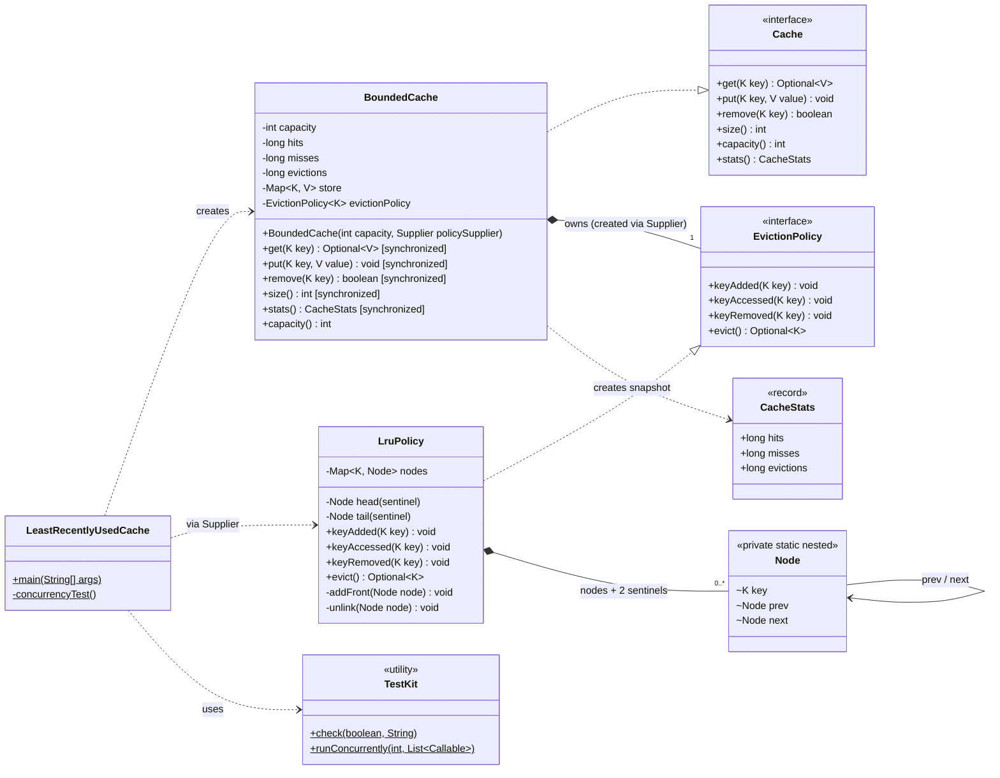

## Class diagram

### Legend
| Arrow | Meaning | Here |
|---|---|---|
| `..\|>` | implements an interface | `BoundedCache` implements `Cache`; `LruPolicy` implements `EvictionPolicy` |
| `*--` | composition: the owner creates the part and controls its lifetime | the cache creates its own policy from the `Supplier`; `LruPolicy` creates its nodes |
| `-->` | association: holds a reference | `Node.prev` and `Node.next` |
| `..>` | dependency: uses it but doesn't keep it | the cache creates a `CacheStats` snapshot; `main` uses `TestKit` |

The diagram doesn't show the type parameters. `Cache` and `BoundedCache` are generic in `<K, V>`. `EvictionPolicy`, `LruPolicy` and `Node` only need `<K>`, because eviction never looks at values.

### Points to make when you explain it
- **Two responsibilities, two classes:** `BoundedCache` stores values and enforces capacity; the policy decides **who gets evicted**. LFU or FIFO means one new class implementing `EvictionPolicy`.
- **The `Supplier` makes the policy owned by the cache.** No policy can be shared between caches by accident.
- **One lock lives in the cache and guards two structures:** the cache's map and the policy's map plus list. That's why the policy needs no thread safety of its own.

---

**Next:**
1. Apply the same `synchronized` change plus its 3 tests to **Parking Lot** (~10 min) and close it.
2. Then **#7 Splitwise**, the start of the intermediate problems.

Want the Splitwise problem statement?