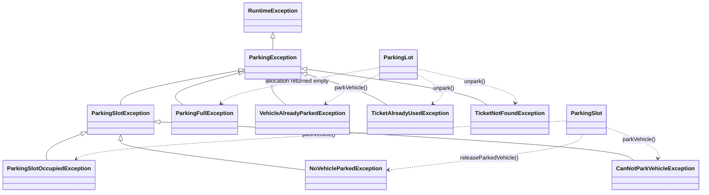
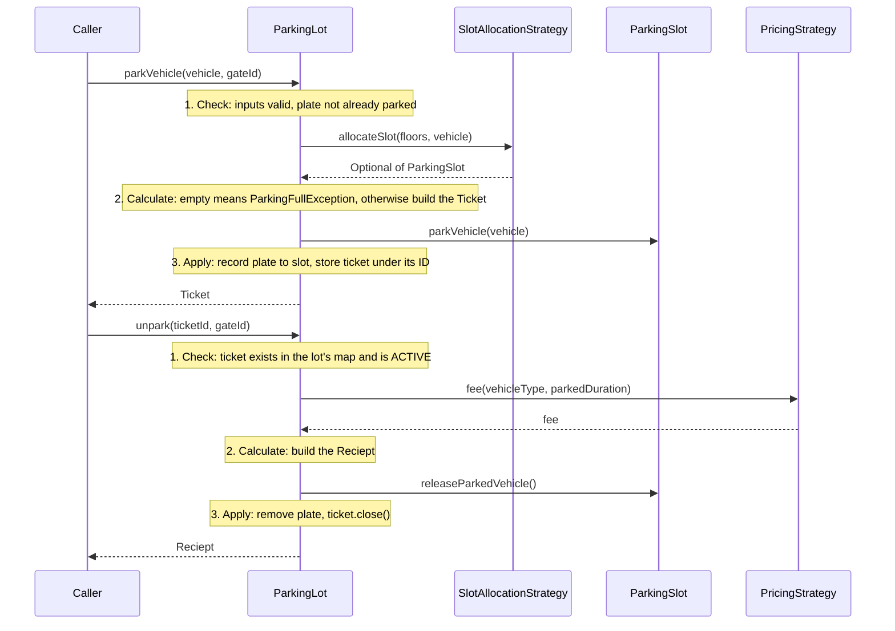

# Parking Lot final solution (v3): class diagram

```mermaid
classDiagram
    direction LR

    %% ---------- Enums and value types ----------
    class SlotSize {
        <<enum>>
        SMALL
        MEDIUM
        LARGE
    }
    class VehicleType {
        <<enum>>
        BIKE
        CAR
        TRUCK
        -Set~SlotSize~ allowedSizes
        +allowedSizes() Set~SlotSize~
        +canParkIn(SlotSize size) boolean
    }
    class TicketStatus {
        <<enum>>
        ACTIVE
        CLOSED
    }
    class Vehicle {
        <<record>>
        +String licensePlateNumber
        +VehicleType vehicleType
    }
    class Ticket {
        <<final>>
        -String ticketId
        -String licensePlateNumber
        -VehicleType vehicleType
        -String spotId
        -String gateId
        -Instant entryTime
        -TicketStatus status
        +ticketId() String
        +spotId() String
        +entryTime() Instant
        +status() TicketStatus
        ~close() void
    }
    class Reciept {
        <<record>>
        +Ticket ticket
        +Instant exitTime
        +Duration parkedDuration
        +int fee
    }
    class Checks {
        <<utility>>
        ~nonBlank(String value, String name)$ String
    }

    %% ---------- Layout ----------
    class ParkingSlot {
        -String slotId
        -int floorNumber
        -int slotNumber
        -SlotSize slotSize
        -Optional~Vehicle~ parkedVehicle
        +isOccupied() boolean
        +canFitVehicle(Vehicle v) boolean
        +parkVehicle(Vehicle v) void
        ~releaseParkedVehicle() Optional~Vehicle~
    }
    class ParkingFloor {
        -int floorNumber
        -Map slotsBySize  (SlotSize → slots sorted by number)
        -List~ParkingSlot~ allSlots
        +ParkingFloor(int floorNumber, List~ParkingSlot~ slots)
        +getSlots(SlotSize size) List~ParkingSlot~
        +getAllSlots() List~ParkingSlot~
    }

    %% ---------- Strategies ----------
    class PricingStrategy {
        <<interface>>
        +fee(VehicleType type, Duration parked) int
    }
    class HourlyPricingStrategy {
        -Map ratePerHour  (VehicleType → rate)
        +fee(VehicleType type, Duration parked) int
        -hoursCharged(Duration parked)$ int
    }
    class SlotAllocationStrategy {
        <<interface>>
        +allocateSlot(List~ParkingFloor~ floors, Vehicle v) Optional~ParkingSlot~
    }
    class DefaultSlotAllocationStrategy {
        +allocateSlot(List~ParkingFloor~ floors, Vehicle v) Optional~ParkingSlot~
    }

    %% ---------- Lot ----------
    class ParkingLot {
        -Clock clock
        -List~ParkingFloor~ floors
        -PricingStrategy pricingStrategy
        -SlotAllocationStrategy slotAllocationStrategy
        -Map parkedVehicles  (plate → ParkingSlot)
        -Map tickets  (ticketId → Ticket)
        +parkVehicle(Vehicle v, String gateId) Ticket
        +unpark(String ticketId, String gateId) Reciept
        +getAvailability() Map  (floor → size → free count)
    }

    %% ---------- Test support ----------
    class Clock {
        <<abstract>>
    }
    class MutableClock {
        -Instant now
        ~advance(Duration d) void
        +instant() Instant
    }
    class PLot {
        +main(String[] args)$
    }

    %% ---------- Relationships ----------
    HourlyPricingStrategy ..|> PricingStrategy
    DefaultSlotAllocationStrategy ..|> SlotAllocationStrategy
    MutableClock --|> Clock

    VehicleType --> SlotSize : allowed sizes
    Vehicle --> VehicleType
    Ticket --> VehicleType
    Ticket --> TicketStatus
    Reciept --> Ticket

    ParkingSlot --> SlotSize
    ParkingSlot o-- "0..1" Vehicle : parked
    ParkingFloor o-- "1..*" ParkingSlot : grouped by size

    ParkingLot o-- "1..*" ParkingFloor : passed in
    ParkingLot o-- "1" PricingStrategy : injected
    ParkingLot o-- "1" SlotAllocationStrategy : injected
    ParkingLot o-- "1" Clock : injected
    ParkingLot *-- "0..*" Ticket : issues and owns
    ParkingLot ..> Reciept : creates

    SlotAllocationStrategy ..> ParkingFloor : reads
    SlotAllocationStrategy ..> ParkingSlot : chooses
    PricingStrategy ..> VehicleType
    PLot ..> ParkingLot : creates and tests
    PLot ..> MutableClock
```

### Exception hierarchy

### Park and unpark: check, then calculate, then apply changes

### Legend
| Mark | Meaning |
|---|---|
| `+` / `~` / `-` | public / package-private / private |
| `$` | static |
| `..\|>` / `--\|>` | implements an interface / extends a class |
| `*--` | composition: the lot creates the tickets and controls their lifetime |
| `o--` | aggregation: the part is passed in from outside (floors, strategies, clock) |
| `-->` | association: holds a reference |
| `..>` | dependency: uses it without keeping it |

### Points to make when you explain this diagram in an interview
- **Two Strategy interfaces, each covering one kind of change.** `PricingStrategy` is just `fee(type, Duration)`; how time is counted (hourly here) is hidden inside each pricing class. `SlotAllocationStrategy` only *chooses* a slot and returns `Optional`. Deciding to throw `ParkingFullException` is the lot's job.
- **The lot keeps the only record of tickets.** Callers hand back just the `ticketId`, so a fake ticket object can't be used. Status goes from `ACTIVE` to `CLOSED`, and closed tickets would be archived in production.
- **The floor layout can't be built wrong.** `ParkingFloor` groups slots by each slot's own size, checks floor numbers and IDs, and sorts once when it's built. `VehicleType.allowedSizes()` holds the fit rules, so reordering `SlotSize` can't break them.
- **Easy to test.** `Clock`, pricing and allocation are all passed in, and `MutableClock` makes the 59, 60 and 61 minute fee cases repeatable.
- **What's still missing is concurrency.** The arrow from `SlotAllocationStrategy` to `ParkingSlot` is where two gates racing at the same moment can be given the same free slot. That's the next exercise.