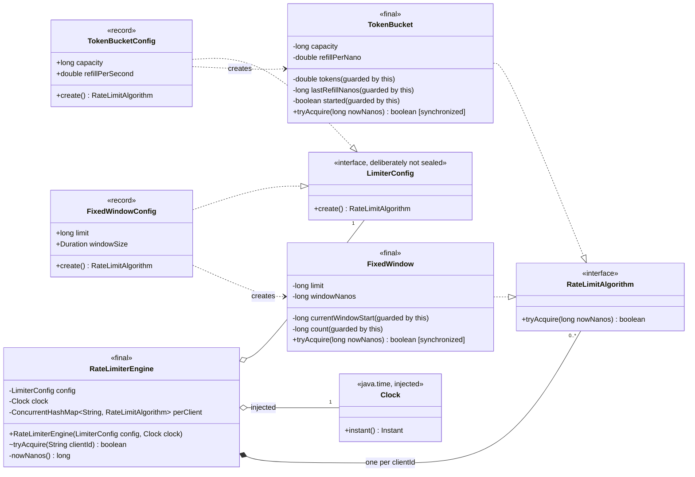
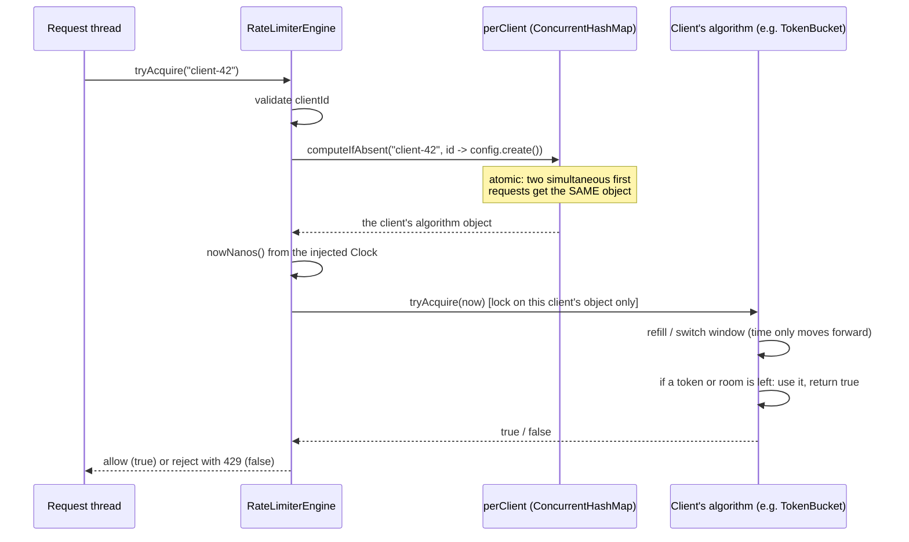
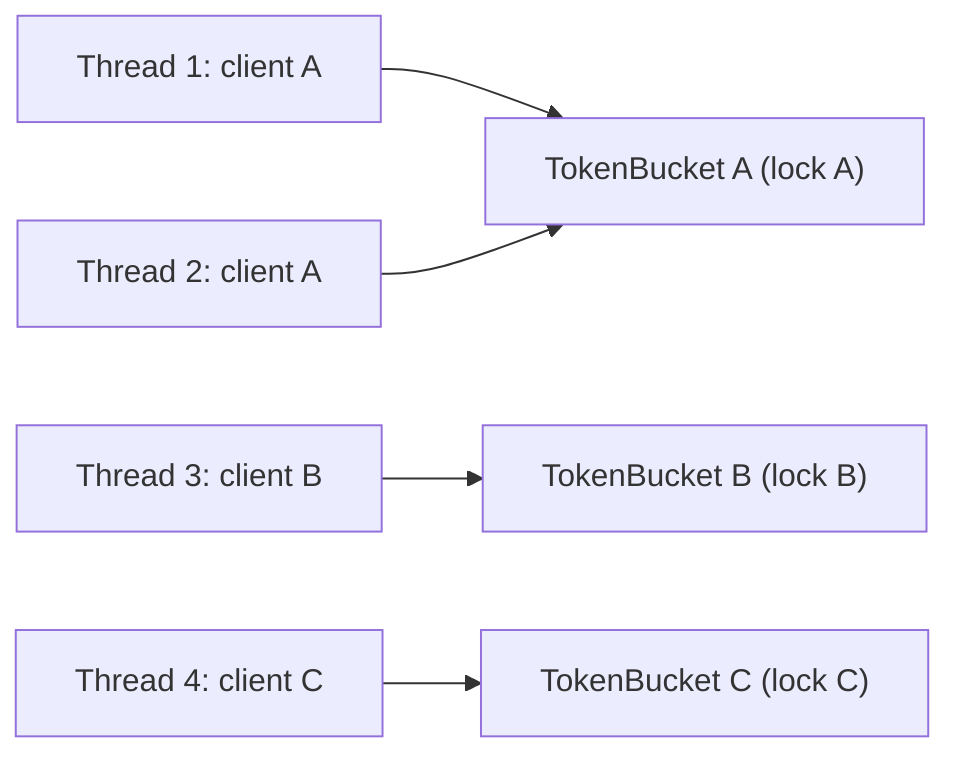

# Rate Limiter v0: class diagram

After Fix A, `TokenBucket`'s fields become `long capacityScaled`, `long ratePerSecond`, `long fullRefillNanos` and `long scaledTokens`. The diagram's shape doesn't change.

## What happens on one `tryAcquire`

## Where the locks are

Threads 1 and 2 take turns on lock A. Threads 3 and 4 run **in parallel** with them, because each client has its own lock and there's no global one.

## Legend
| Arrow | Meaning | Here |
|---|---|---|
| `..\|>` | implements an interface | each config implements `LimiterConfig`; each algorithm implements `RateLimitAlgorithm` |
| `*--` | composition: the owner creates the part and controls its lifetime | the engine creates one algorithm object per client in `perClient` |
| `o--` | aggregation: the part is passed in | the config and the `Clock` are given to the engine |
| `..>` | dependency: uses it but doesn't keep it | each config creates its matching algorithm |

## Points to make when you explain it
| Point | Why it matters |
|---|---|
| **Strategy:** `RateLimitAlgorithm` | Token bucket and fixed window are interchangeable. A sliding-window version would just be one more class. |
| **Each config is also the factory:** `LimiterConfig.create()` | A new algorithm is one new record plus one new class, with no switch to edit. It's **deliberately not `sealed`**, because a `permits` list would have to be edited each time. |
| **One lock per client** | `synchronized` on each client's own object. Clients never block each other. A global lock would make every request in the service wait in one queue. |
| **`computeIfAbsent`** | Creates each client's object atomically. `containsKey` followed by `put` would let two simultaneous first requests create two buckets, doubling that client's limit. |
| **Time only moves forward** | A thread that read the clock earlier but got the lock later can't double-count a refill or reset a window. |
| **Time comes from an injected `Clock`** | Tests can control time exactly. In production, use a source that never goes backwards, such as `System.nanoTime()`. |