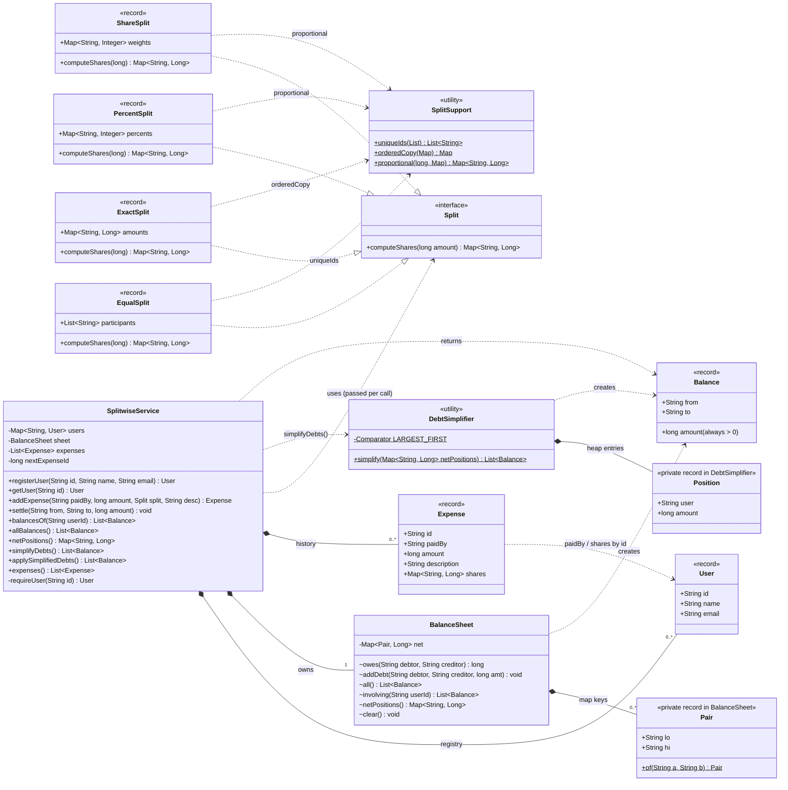
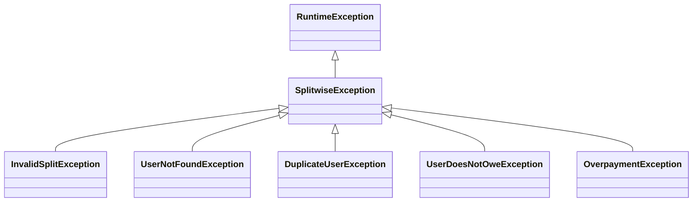
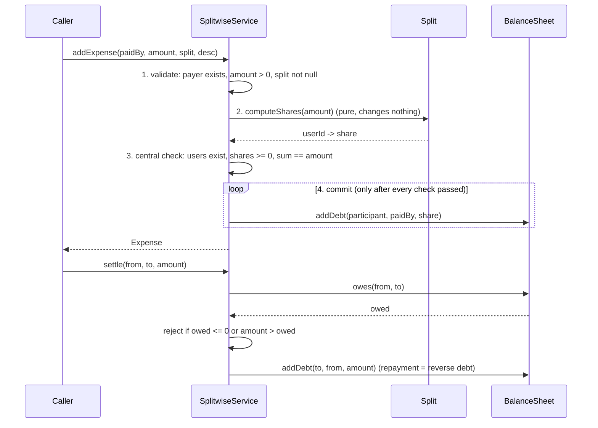

# Splitwise solution: class diagram

## Exception hierarchy

## What happens in `addExpense` and `settle`

## Legend
| Arrow | Meaning | Here |
|---|---|---|
| `..\|>` | implements an interface | the 4 split records implement `Split` |
| `<\|--` | extends a class | the exception classes |
| `*--` | composition: the owner creates the part and controls its lifetime | the service owns its `BalanceSheet`, the users and the expense history; `BalanceSheet` owns its `Pair` keys |
| `..>` | dependency: uses it but doesn't keep it | the service uses the `Split` passed in and calls `DebtSimplifier`; splits call `SplitSupport` |

## Points to make when you explain the diagram
- **Strategy with the input built in:** each split record holds its own input (participants, amounts, percentages, weights). Adding `ShareSplit` needed **no** registry, no switch statement, and no edits.
- **The sign rule lives in one place:** only `BalanceSheet.owes()` and `addDebt()` know the "positive means lo owes hi" convention. Everything else thinks in terms of debtor and creditor, which removes the whole class of bug from your v0.
- **Two layers of validation:** each split checks *its own* rules (percentages add up to 100, exact amounts match). The service checks the rule *every* split must obey (registered users, shares add up to the amount), so a buggy future split can't corrupt the balances.
- **Pure helpers:** `DebtSimplifier` and `SplitSupport` change nothing, so they're easy to test directly. `simplifyDebts()` only suggests payments; `applySimplifiedDebts()` is the explicit, separate call that rewrites the balances.
- **Ids instead of object references:** `Expense` and `Balance` refer to users by `String` id. That avoids the record-equality trap from v0, where a user with a different email counted as a different user.

Time for a 30-second eye break: look at something at least 20 feet (about 6 m) away.

Splitwise is now done, with its class diagram. Next on the list is #8 Elevator System, a good one for practising the State pattern and scheduling. Say "Elevator" when you're back and I'll send its scoped problem statement.