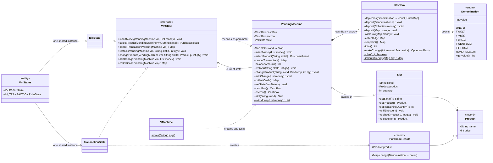
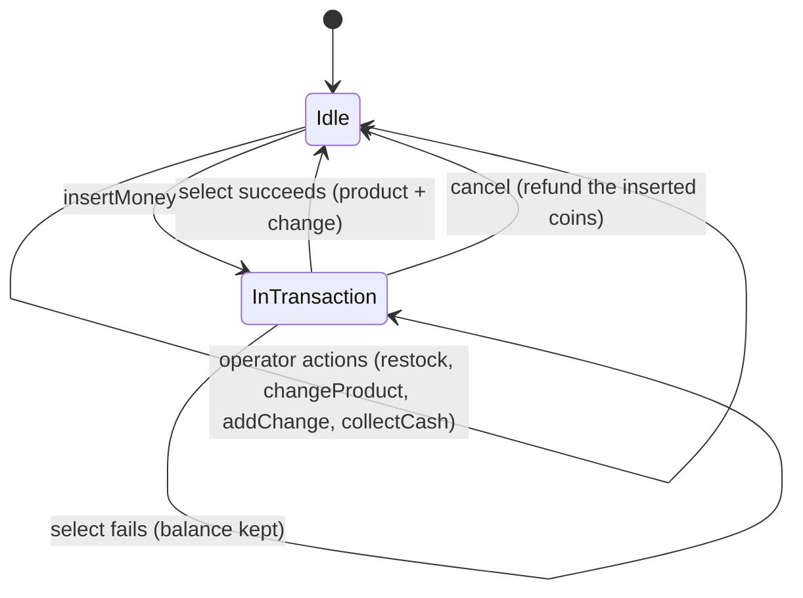
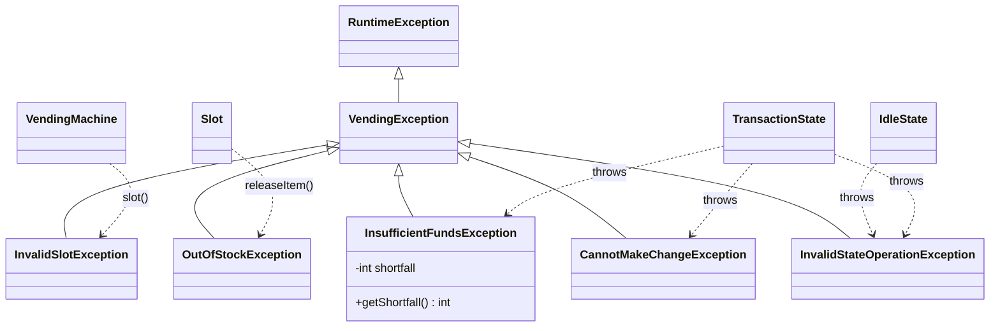

# Vending Machine final solution (v3): class diagram

### State transitions

Actions not shown on an arrow are invalid in that state and throw `InvalidStateOperationException`. That covers select or cancel while Idle, and any operator action during a transaction.

### Exception hierarchy

### Legend
| Mark | Meaning |
|---|---|
| `+` / `~` / `-` | public / package-private / private |
| `$` | static |
| `..\|>` | implements an interface |
| `*--` | composition: the owner creates the part and controls its lifetime (the machine creates both `CashBox`es) |
| `o--` | aggregation: the part is passed in from outside (slots are given to the constructor) |
| `-->` | association: holds a reference |
| `..>` | dependency: uses it without keeping it |

### Points to make when you explain this diagram in an interview
- **State pattern.** `VendingMachine` holds the current state and forwards every public call to it. The states hold no data and get the machine as a parameter, so `VmStates` creates each one once and reuses it.
- **One `CashBox` class, used twice.** One instance is the machine's own money, the other holds the coins the current customer has inserted. Cancelling just empties the customer's box, so a refund can never fail. Change is worked out from both boxes, so the customer's own coins can be given back as change.
- **Access levels.** The public API is the only way in, and it always goes through the current state. The `~` helpers are only for the states.
- **Check everything first, then apply.** `makeChange` only calculates; it doesn't change anything. `selectProduct` runs every check before touching any money or stock, so a failed purchase leaves the machine exactly as it was.

Ready for #2 Parking Lot whenever you are.